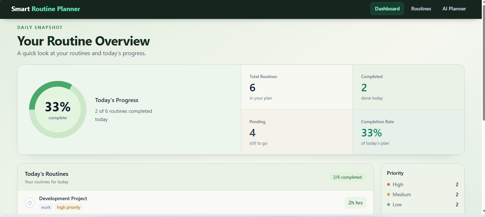
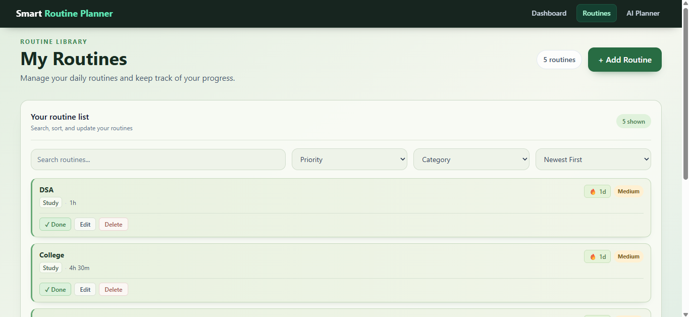
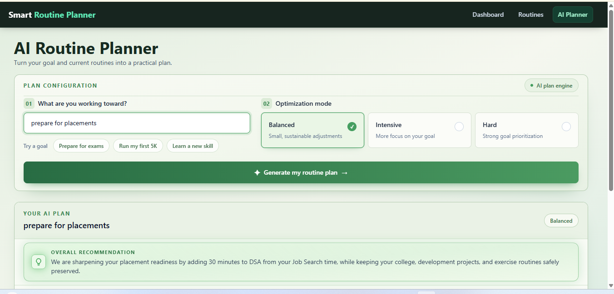

# Smart Routine Planner

A full-stack routine planning and tracking application for organizing routines, tracking progress, and adjusting time around specific goals.

[**Live Demo →**](https://smart-routine-tracker.vercel.app/)

## Features

### Routine Management
- Add, edit, and delete routines
- Set categories, priorities, and target time
- Mark routines as completed
- Track completion streaks
- Search, filter, and sort routines

### Dashboard
- Track overall routine progress
- View completion statistics
- See routine distribution by category and priority

### AI Planner
The AI Planner works with the routines already stored in the application.

Users enter a goal and choose a planning mode — **Balanced, Intensive, or Hard**.

The AI can:
- Increase time for routines related to the goal
- Reduce time from more flexible routines
- Suggest a new routine when something important is missing
- Show suggested changes for review before applying them

Once approved, the changes are sent to the backend and update the routines stored in MongoDB.

## Tech Stack

**Frontend:** React, Tailwind CSS, Axios

**Backend:** Node.js, Express.js, REST APIs

**Database:** MongoDB, Mongoose

**AI:** Google Gemini API

**Deployment:** Vercel, Render

## Screenshots

## What I Learned

One of the biggest things I learned from this project was that integrating an LLM is more than sending data to an API and displaying the response.

For the AI Planner, the first responses were not always useful. The model could make changes that didn't make sense for the user's routine or prioritize the wrong things.

I had to iteratively refine the prompt and define clearer boundaries for how the AI should behave — what routines to protect, where time could be reallocated, how different planning modes should affect the recommendations, when a new routine should be suggested, and how changes should be structured before they reached the application.

This made me understand that a useful AI feature needs more than an LLM. The model needs context, constraints, a structured output, and product-specific rules that guide it toward the kind of decisions the application is actually supposed to make.

The final result wasn't just "Gemini connected to my app." It was an AI feature designed around the way a routine-planning product should behave.